# Lumina

[Русский](README.md) · **English**

Lumina is a Windows app for role-play chats with AI characters. The language model runs entirely on your own computer: no cloud, no subscriptions, no external moderation. You can also play from an iPhone through Safari over Wi‑Fi.

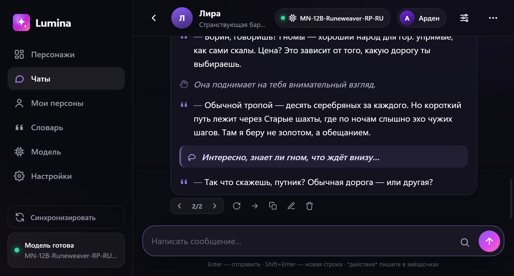

> The repository does not include AI model files (they weigh 5–15 GB). Download a `.gguf` model separately — see [Model](#model).
>
> The interface is in Russian; the screenshots show the Russian UI.

## Features

### Characters and chats
- Character cards: avatar, description, personality, scenario, first message (plus alternatives), special rules, example dialogue.
- Import of **Character Card V1/V2/V3** (PNG and JSON) — the same cards SillyTavern and chub.ai use.
- **Personas** — who you play as: name, appearance, personality.
- Multiple reply variants (‹ › arrows or swipe on the phone), Continue, Edit, Delete, history rollback.
- Reply styles: universal (separate blocks for *actions*, — speech and ((thoughts))), first- and third-person "book" prose, classic RP, and your own custom styles defined by an example.
- Per-chat settings: memory length, "chat context" (notes or a summary the model can write for you), style and reply length.

### Replies arrive complete
- No letter-by-letter typing: the model writes a draft, checks it and sends the finished text. While it works you see the stage and elapsed time — "writing… 12 / 60 s", then "checking…".
- **Reply time limit** — from 20 seconds to 5 minutes. If the model runs out of time, the reply is cut at the last complete sentence.
- **Model review pass** fixes spelling, typos and logical inconsistencies with your message (when there is time).
- **Dictionary spell-check** — offline, Hunspell with a Russian dictionary, takes milliseconds. Obvious typos are fixed immediately; doubtful words are handed to the model review. Names and terms from the character card are left alone.

| Reply in progress | Reply settings |
|---|---|
| 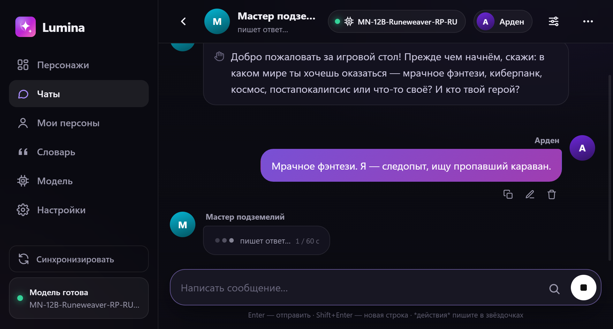 | 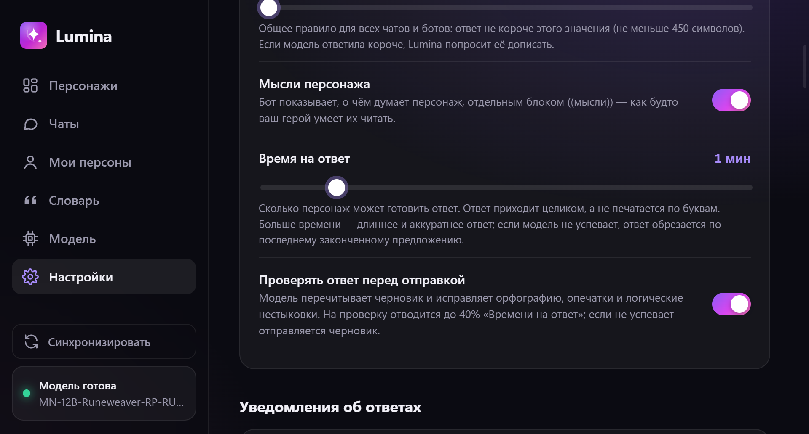 |

### Text quality
- **Sampler presets**: Stable, Balanced, Creative. Fine-tuning (temperature, min‑p, top‑p, repetition penalty) lives under "Advanced", with warnings for risky values.
- **DRY** — suppresses repeated phrases without breaking individual words and endings (a classic repetition penalty mangles Russian word endings).
- The model is explicitly told to respond to your latest message and to keep earlier events in mind.

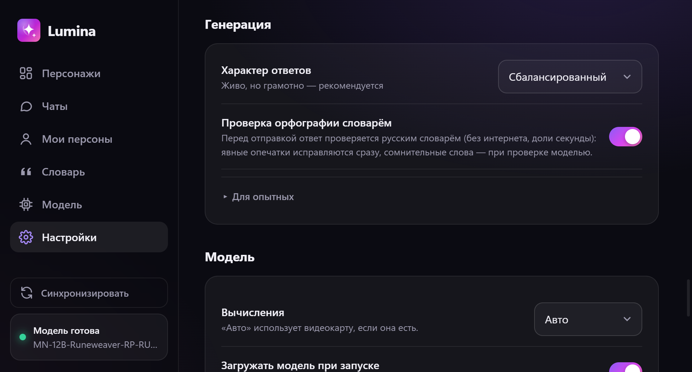

### Lorebook and term lookup
- A dictionary of slang, terms and world facts. When a keyword appears in recent messages, its meaning is silently added to the prompt so the model uses the word correctly. Works offline.
- Keys can be word stems: «академи» matches «академия», «академии».
- Entries can be global or bound to one character; "Always remember" mode for key facts.
- **Online lookup** — only when you ask: select a word in the chat and press 🔍 in the message box. Searches Wiktionary, Wikipedia and DuckDuckGo. Only the word itself is sent, never your chat. Results can be saved to the lorebook or condensed into 1–2 sentences by the local model.

| Lorebook | Term lookup |
|---|---|
| 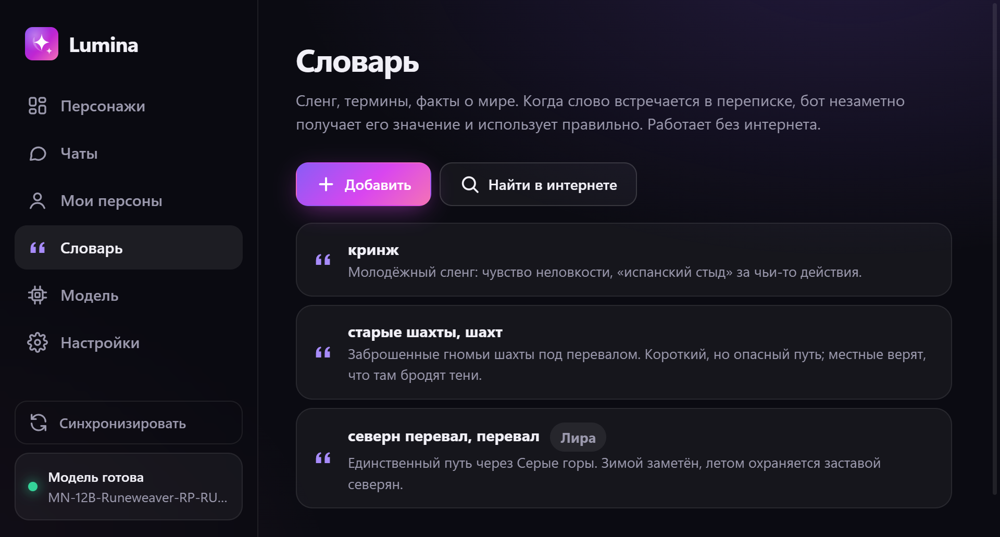 | 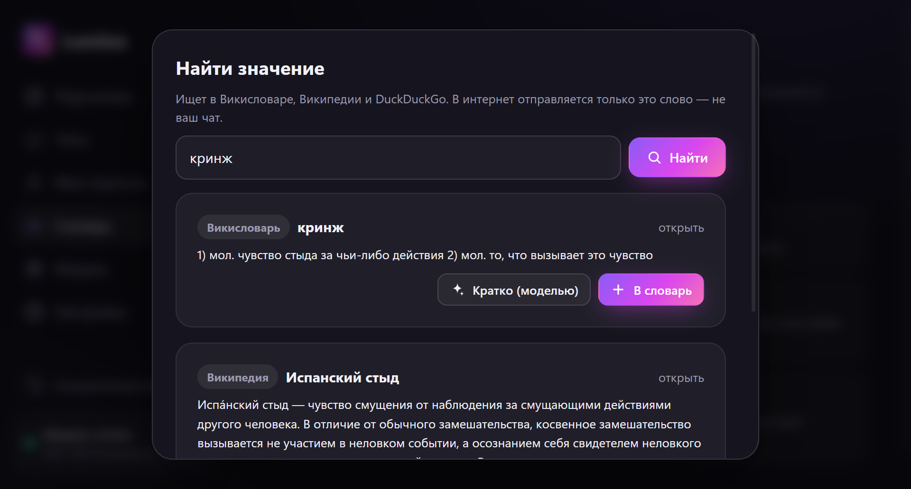 |

### Models
- Any **GGUF** model (llama.cpp). GPU acceleration via **Vulkan** (NVIDIA / AMD / Intel), CPU fallback.
- If a model does not fit into VRAM, Lumina picks how many layers to keep on the GPU and reserves memory for the context automatically.
- **Switch models right inside a chat** — the model chip in the chat header.
- Models folder: anything in `%APPDATA%\Lumina\data\models` shows up in the list automatically.

| Models | Switching models in a chat |
|---|---|
| 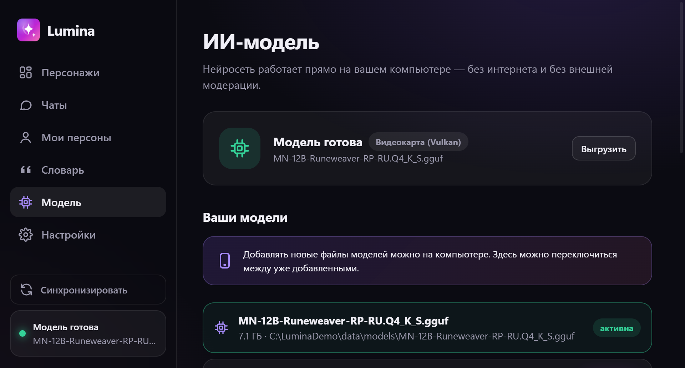 | 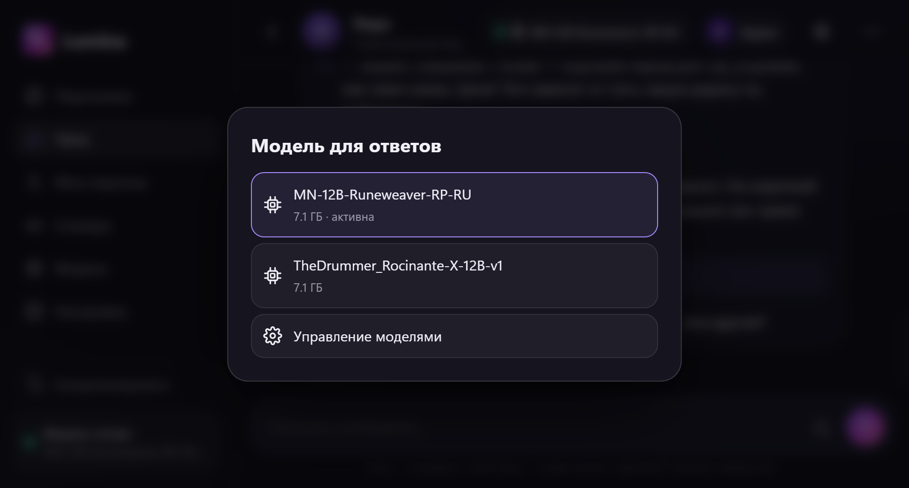 |

### Phone and notifications
- The same interface on PC and iPhone. Connect over Wi‑Fi with a QR code or PIN; add it to the Home Screen in Safari.
- Closing the window minimizes Lumina to the tray, so the phone stays connected.
- Reply notifications: in-app sound, Windows notifications, and **iPhone push** via the free [ntfy](https://ntfy.sh) app (even when the phone is locked).

| Home | Chat | Model switch | Notifications |
|---|---|---|---|
| 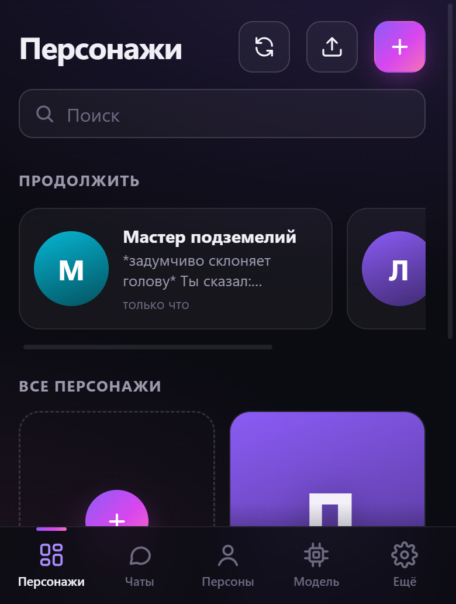 | 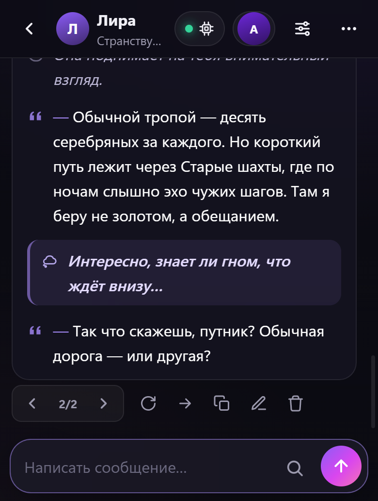 | 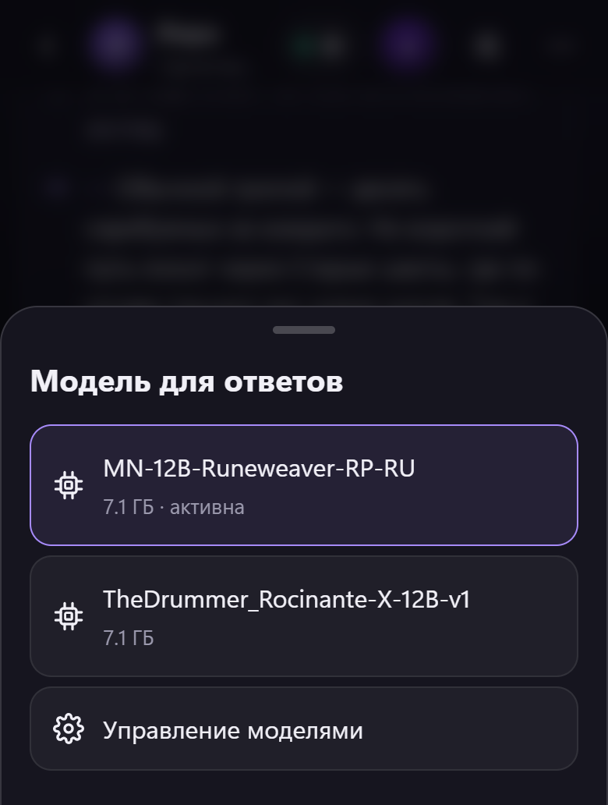 | 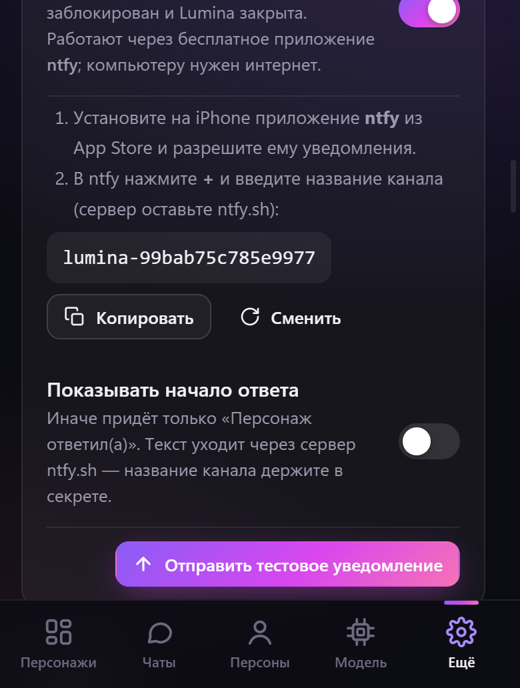 |

## Installation

1. Download `Lumina-Setup-x.y.z.exe` from [Releases](../../releases) or build it yourself (see below). Windows SmartScreen may warn that the installer is unsigned: "More info" → "Run anyway".
2. Download a `.gguf` model (see below). In the «Модель» (Model) section, click «Выбрать файл модели» (Choose model file), drag the file into the window, or drop it into the models folder.
3. Pick a character and start chatting.

### Model

Look for GGUF models on [Hugging Face](https://huggingface.co/models?library=gguf). Choose the quantization by your VRAM:

| VRAM | Model size | Quantization |
|---|---|---|
| 6–8 GB | 7–12B | `Q4_K_S` / `IQ4_XS` |
| 10–12 GB | 12–14B | `Q4_K_M` / `Q5_K_M` |
| 16 GB | 20–24B | `Q4_K_M` |
| 24 GB+ | 27–35B | `Q4_K_M` / `Q5_K_M` |

For Russian, models based on Qwen, Gemma and Mistral Nemo/Small work best.

### Playing from an iPhone

1. «Настройки» (Settings) → «Играть с телефона» (Play from phone) → enable Wi‑Fi access.
2. If Windows asks about the firewall, allow access on **private networks**.
3. Point the iPhone camera at the QR code, or open the address in Safari and enter the PIN.
4. In Safari: Share → Add to Home Screen.

## Where data is stored

Everything stays local in `%APPDATA%\Lumina\data`: characters (`bots.json`), personas, chats (`chats\*.json`), the lorebook (`lorebook.json`), settings and models (`models\`). The app goes online only when you act: term lookup and ntfy push notifications (without reply text by default).

## Building from source

Requires Windows and Node.js 22+.

```bash
npm install
npm start             # run the app
npm run dist          # build the installer → release/
npm run server:mock   # server and UI only, no model (for development): http://127.0.0.1:3737
```

**CUDA for NVIDIA.** By default the installer ships Vulkan: it works on any GPU and is smaller. To add CUDA, remove the `!node_modules/@node-llama-cpp/win-x64-cuda/**` and `…cuda-ext/**` lines from `package.json` → `build.files` and rebuild (the installer grows by about 600 MB).

## Project layout

```
electron/main.mjs     app window, tray, Windows notifications, model file picker
electron/preload.cjs  bridge between the window and the system
server/server.mjs     HTTP API, reply pipeline (draft → spell-check → review), Wi‑Fi access with PIN, ntfy
server/llm.mjs        AI engine (node-llama-cpp): VRAM-aware model loading, samplers, DRY
server/prompt.mjs     prompt assembly from character, persona, style and reply length
server/lore.mjs       lorebook: picking terms for the prompt and online lookup
server/spell.mjs      offline spell-check (Hunspell + dictionary-ru)
server/store.mjs      JSON storage, settings and their migrations
web/                  user interface (shared by PC and iPhone)
docs/screenshots/     screenshots for the README
```

## Built with

[Electron](https://www.electronjs.org/) · [node-llama-cpp](https://node-llama-cpp.withcat.ai/) (llama.cpp) · [hunspell-asm](https://github.com/kwonoj/hunspell-asm) + [dictionary-ru](https://github.com/wooorm/dictionaries) · plain JavaScript UI, no framework.

## License

[MIT](LICENSE). The `dictionary-ru` dictionary is distributed under its own license (see the package).
