# Lumina

**Русский** · [English](README.en.md)

[](https://www.donationalerts.com/r/wompee)

Lumina — программа для Windows для ролевых чатов с ИИ-персонажами. Нейросеть работает прямо на вашем компьютере: без облака, подписок и внешней модерации. Играть можно и с iPhone — через Safari по Wi‑Fi.

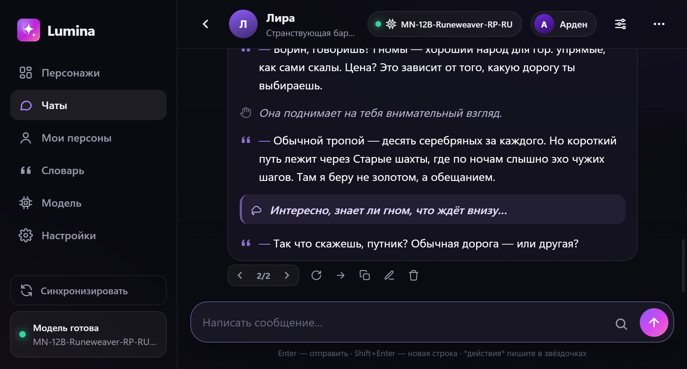

> В репозитории нет файлов ИИ-моделей (они весят 5–15 ГБ). Модель в формате `.gguf` скачивается отдельно — см. раздел [«Модель»](#модель).

## Возможности

### Персонажи и чаты
- Карточки персонажей: аватар, описание, характер, сценарий, первое сообщение (и альтернативные), особые правила, примеры реплик.
- Импорт карточек **Character Card V1/V2/V3** (PNG и JSON) — тех же, что у SillyTavern и chub.ai.
- **Персоны** — кем играете вы: имя, внешность, характер.
- Несколько вариантов ответа (стрелки ‹ › или свайп на телефоне), «Продолжить», «Изменить», «Удалить», откат истории.
- Стили оформления: универсальный (блоки *действий*, — реплик и ((мыслей))), «книга» от 1-го и 3-го лица, ролевой, а также свои стили с примером.
- Настройки отдельного чата: память, «контекст чата» (заметки или сводка, которую модель может составить сама), стиль и длина ответа.

### Ответ приходит целиком
- Ответ не печатается по буквам: модель пишет черновик, проверяет его и присылает готовый текст. Пока идёт работа, видно этап и время: «пишет ответ… 12 / 60 с», затем «проверяет ответ…».
- **Время на ответ** — от 20 секунд до 5 минут. Если модель не успевает, ответ обрезается по последнему законченному предложению.
- **Проверка моделью**: исправление орфографии, опечаток и логических нестыковок с вашим сообщением (если хватает времени).
- **Проверка орфографии словарём** — офлайн, через Hunspell и русский словарь, за доли секунды. Явные опечатки исправляются сразу, сомнительные слова передаются модели. Имена и термины из карточки не трогаются.

| Ответ готовится | Настройки ответов |
|---|---|
| 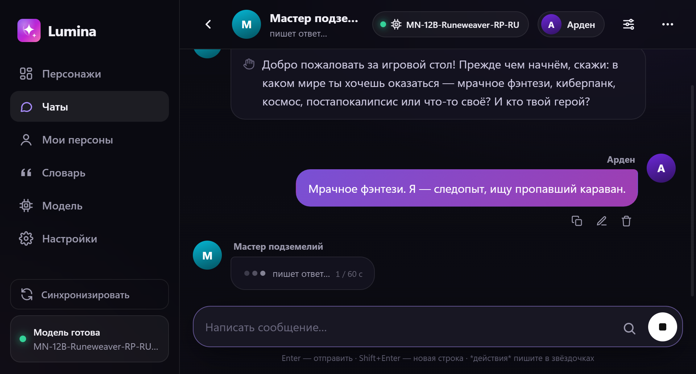 | 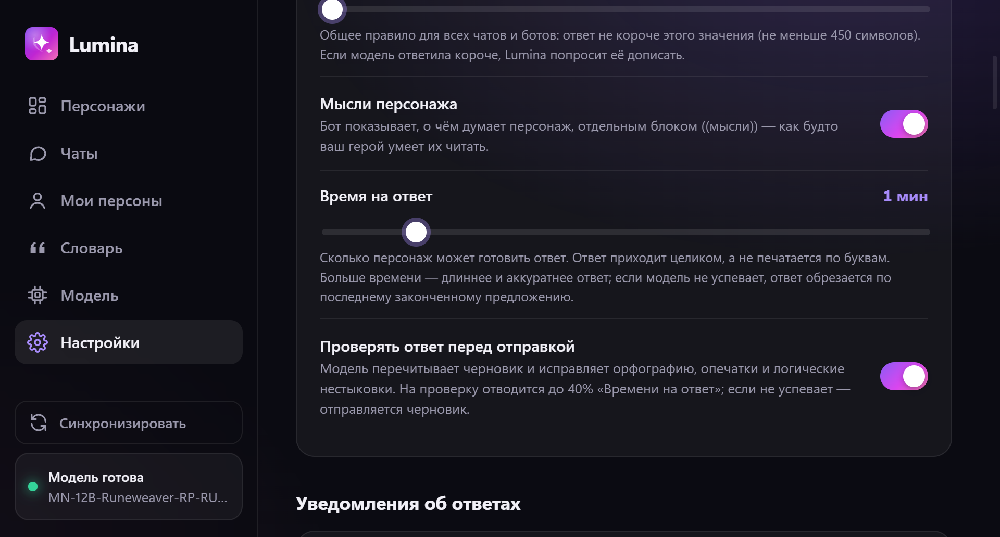 |

### Качество текста
- **Наборы параметров**: «Стабильный», «Сбалансированный», «Творческий». Тонкая настройка (temperature, min‑p, top‑p, штраф за повторы) — в разделе «Для опытных», с предупреждением о рискованных значениях.
- **DRY** — антиповтор целых фраз, который не ломает отдельные слова и окончания (классический штраф за повторы в русском искажает слова).
- Модель явно получает указание отвечать на последнее сообщение и помнить предыдущие события.

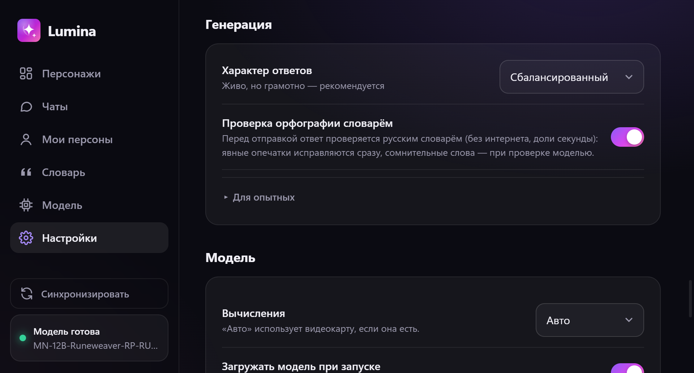

### Словарь (лорбук) и поиск терминов
- Словарь сленга, терминов и фактов о мире. Когда ключевое слово встречается в последних сообщениях, его значение незаметно добавляется в промпт, и модель использует слово правильно. Работает без интернета.
- Ключ можно задавать началом слова: «академи» сработает на «академия», «академии».
- Запись может быть общей или только для одного персонажа; режим «Всегда помнить» — для важных фактов.
- **Поиск значения в интернете** — только по нажатию: выделите слово в чате и нажмите 🔍 в поле ввода. Поиск идёт в Викисловаре, Википедии и DuckDuckGo. В интернет уходит только само слово, не ваш чат. Найденное можно сохранить в словарь или попросить локальную модель пересказать в 1–2 предложениях.

| Словарь | Поиск значения |
|---|---|
| 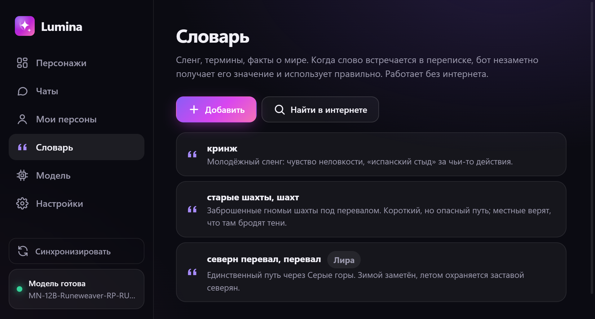 | 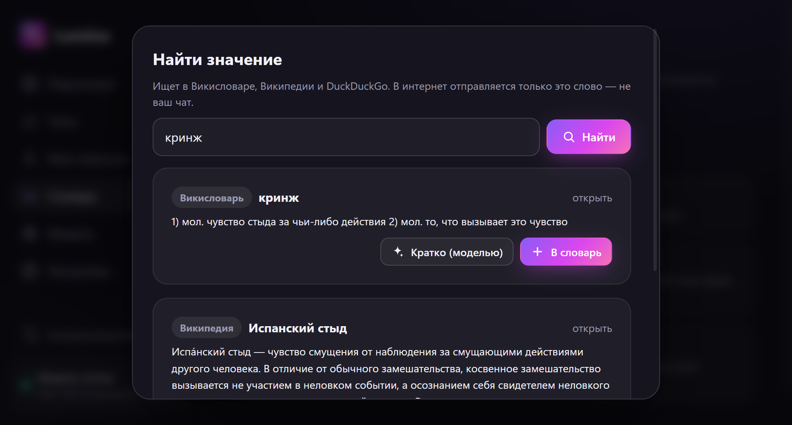 |

### Модели
- Любые модели в формате **GGUF** (llama.cpp). Видеокарта через **Vulkan** (NVIDIA / AMD / Intel), без неё — на процессоре.
- Если модель не помещается в видеопамять, Lumina сама подбирает, сколько слоёв оставить на видеокарте, и резервирует память под контекст.
- **Смена модели прямо в чате** — кнопка с названием модели в шапке.
- Папка моделей: всё, что лежит в `%APPDATA%\Lumina\data\models`, появляется в списке автоматически.

| Модели | Смена модели в чате |
|---|---|
| 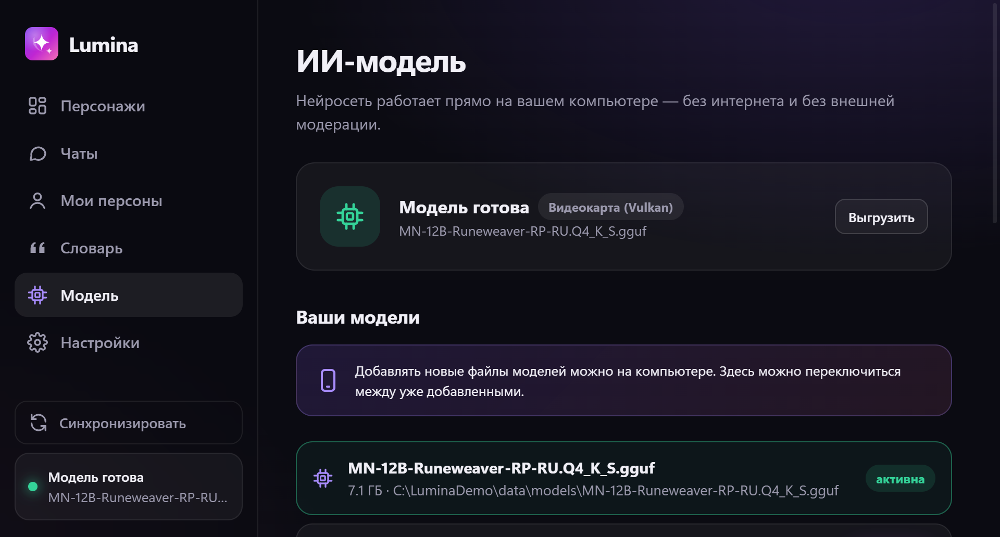 | 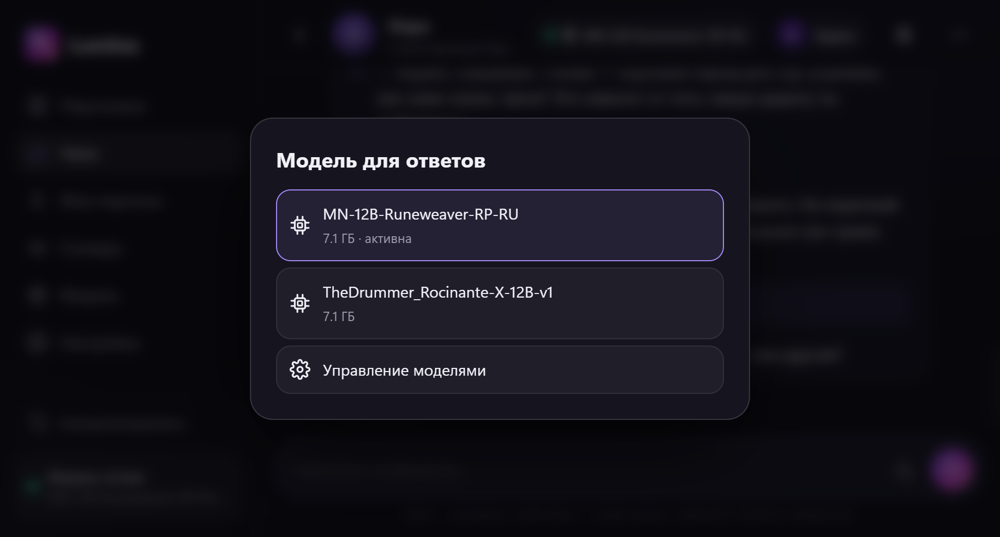 |

### Телефон и уведомления
- Интерфейс одинаковый для ПК и iPhone. Подключение по Wi‑Fi через QR-код или PIN; в Safari можно добавить на экран «Домой».
- При закрытии окна Lumina сворачивается в трей, и телефон остаётся подключённым.
- Уведомления о готовом ответе: звук в приложении, уведомления Windows, **push на iPhone** через бесплатное приложение [ntfy](https://ntfy.sh) (даже при заблокированном экране).

| Главная | Чат | Смена модели | Уведомления |
|---|---|---|---|
| 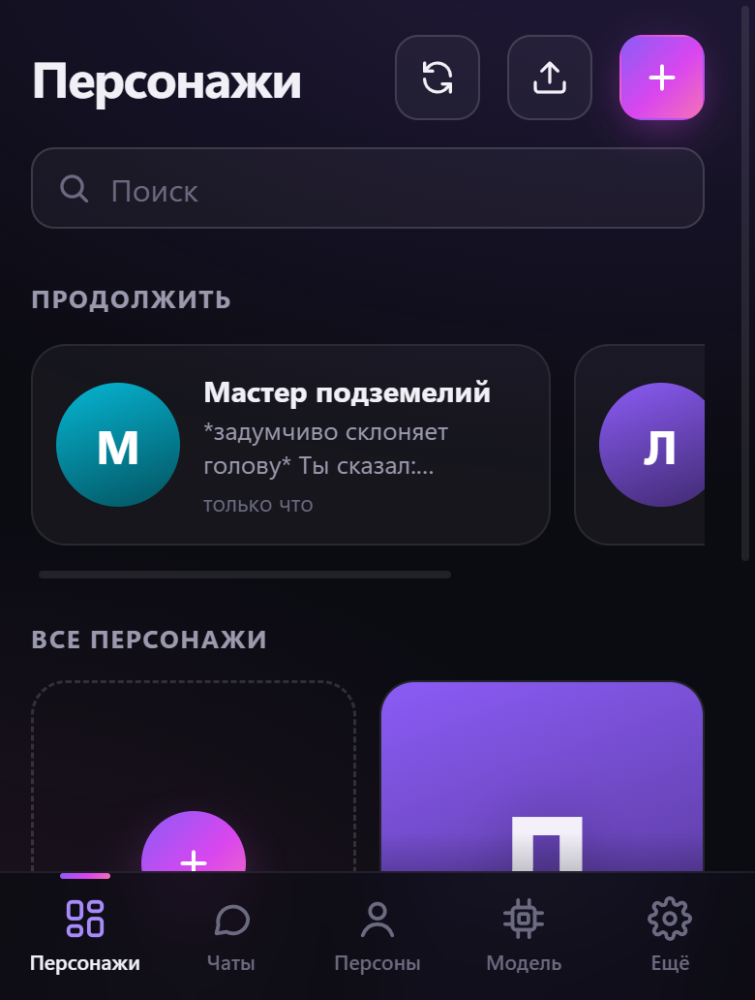 | 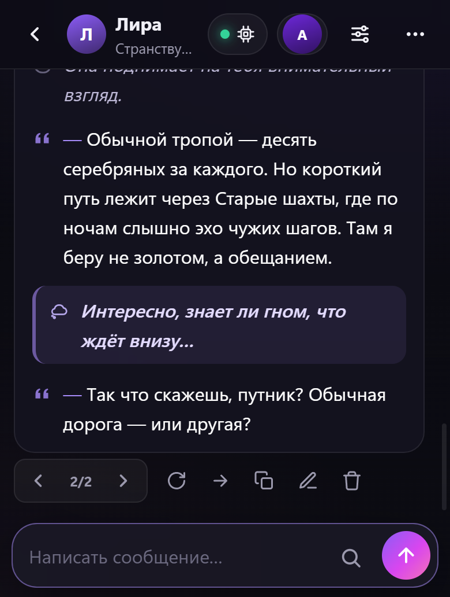 | 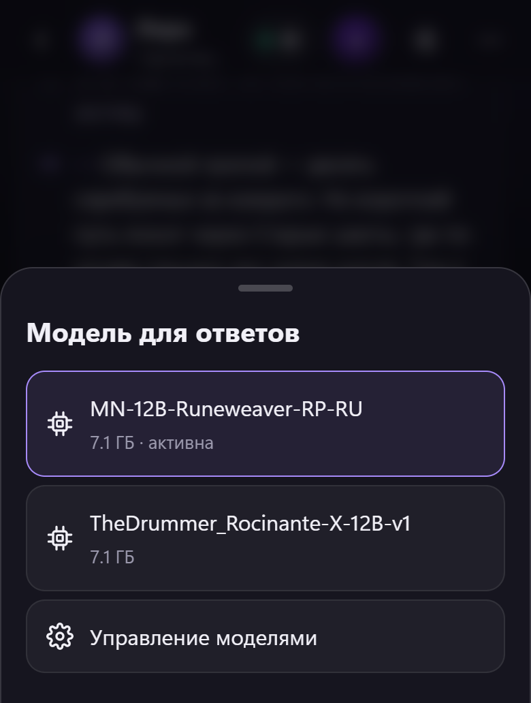 | 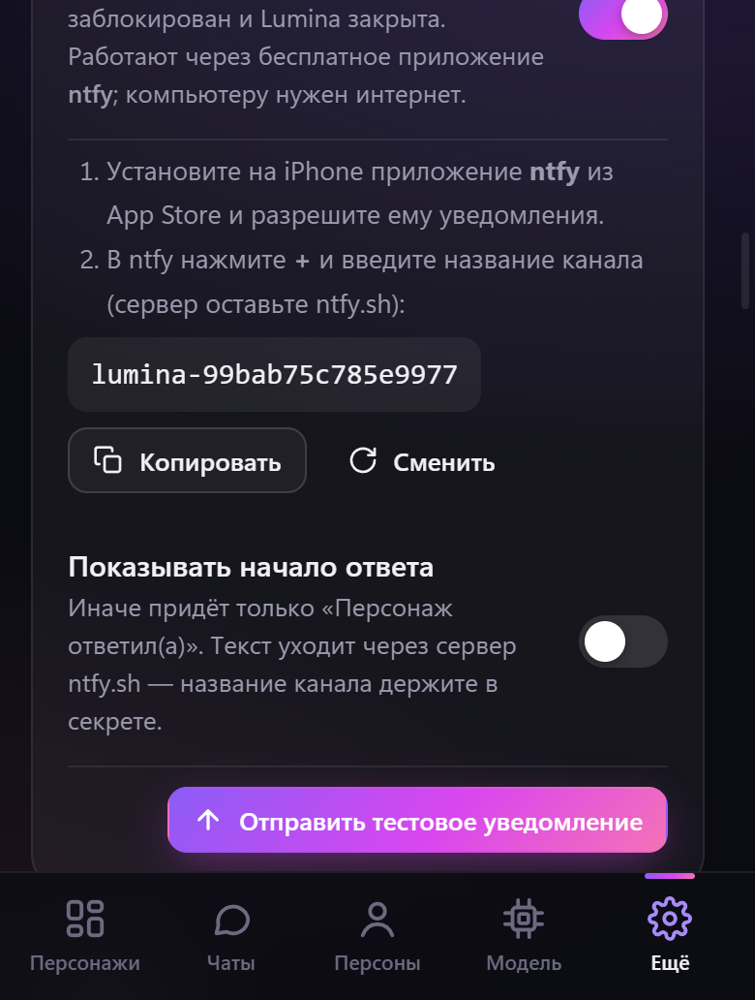 |

### Язык интерфейса
- Русский и английский: «Настройки» → «Язык интерфейса». Выбор общий для ПК и телефона; трей и уведомления Windows тоже переключаются.
- Переписка, карточки персонажей и системный промпт не переводятся — персонажи отвечают на том языке, на котором пишете вы.

## Установка

1. Скачайте установщик `Lumina-Setup-x.y.z.exe` из [Releases](../../releases) или соберите его сами (см. ниже). Windows SmartScreen может предупредить, что установщик не подписан: «Подробнее» → «Выполнить в любом случае».
2. Скачайте модель `.gguf` (см. ниже) и в разделе «Модель» нажмите «Выбрать файл модели», перетащите файл в окно или положите его в «Папку моделей».
3. Выберите персонажа и начните чат.

### Модель

Ищите на [Hugging Face](https://huggingface.co/models?library=gguf) модели в формате GGUF. Квантование подбирайте по объёму видеопамяти:

| Видеопамять | Размер модели | Квантование |
|---|---|---|
| 6–8 ГБ | 7–12B | `Q4_K_S` / `IQ4_XS` |
| 10–12 ГБ | 12–14B | `Q4_K_M` / `Q5_K_M` |
| 16 ГБ | 20–24B | `Q4_K_M` |
| 24 ГБ+ | 27–35B | `Q4_K_M` / `Q5_K_M` |

Для русского языка лучше всего подходят модели на базе Qwen, Gemma и Mistral Nemo/Small.

### Игра с iPhone

1. «Настройки» → «Играть с телефона» → включите «Доступ по Wi‑Fi».
2. Если Windows спросит про брандмауэр, разрешите доступ в **частных сетях**.
3. Наведите камеру iPhone на QR-код или откройте адрес в Safari и введите PIN.
4. В Safari: «Поделиться» → «На экран Домой».

## Где хранятся данные

Всё хранится локально в `%APPDATA%\Lumina\data`: персонажи (`bots.json`), персоны, чаты (`chats\*.json`), словарь (`lorebook.json`), настройки и модели (`models\`). В интернет программа обращается только по вашему действию: поиск значения слова и push-уведомления через ntfy (по умолчанию без текста ответа).

## Сборка из исходников

Нужны Windows и Node.js 22+.

```bash
npm install
npm start             # запустить программу
npm run dist          # собрать установщик → папка release/
npm run server:mock   # только сервер и интерфейс, без модели (для разработки): http://127.0.0.1:3737
```

**CUDA для NVIDIA.** По умолчанию в установщик входит Vulkan: он работает на любых видеокартах и весит меньше. Чтобы добавить CUDA, удалите из `package.json` → `build.files` строки `!node_modules/@node-llama-cpp/win-x64-cuda/**` и `…cuda-ext/**` и пересоберите (установщик вырастет примерно на 600 МБ).

## Структура

```
electron/main.mjs     окно программы, трей, уведомления Windows, выбор файла модели
electron/preload.cjs  мост между окном и системой
server/server.mjs     HTTP API, генерация ответа (черновик → орфография → проверка), доступ по Wi‑Fi с PIN, ntfy
server/llm.mjs        движок ИИ (node-llama-cpp): загрузка модели под объём видеопамяти, сэмплеры, DRY
server/prompt.mjs     сборка промпта из персонажа, персоны, стиля и длины ответа
server/lore.mjs       словарь: подбор терминов для промпта и поиск значений в интернете
server/spell.mjs      офлайн-проверка орфографии (Hunspell + dictionary-ru)
server/store.mjs      хранение данных в JSON, настройки и их миграции
web/i18n.js           английский перевод интерфейса
web/                  интерфейс (одинаковый для ПК и iPhone)
docs/screenshots/     скриншоты для README
```

## Технологии

[Electron](https://www.electronjs.org/) · [node-llama-cpp](https://node-llama-cpp.withcat.ai/) (llama.cpp) · [hunspell-asm](https://github.com/kwonoj/hunspell-asm) + [dictionary-ru](https://github.com/wooorm/dictionaries) · интерфейс на чистом JavaScript без фреймворков.

## Поддержать автора

Lumina бесплатна и с открытым кодом. Если программа вам нравится, можно поддержать разработку донатом:

**👉 [donationalerts.com/r/wompee](https://www.donationalerts.com/r/wompee)**

Та же ссылка есть в самой программе: «Настройки» → «Поддержать автора».

## Лицензия

[MIT](LICENSE). Словарь `dictionary-ru` распространяется по своей лицензии (см. пакет).
